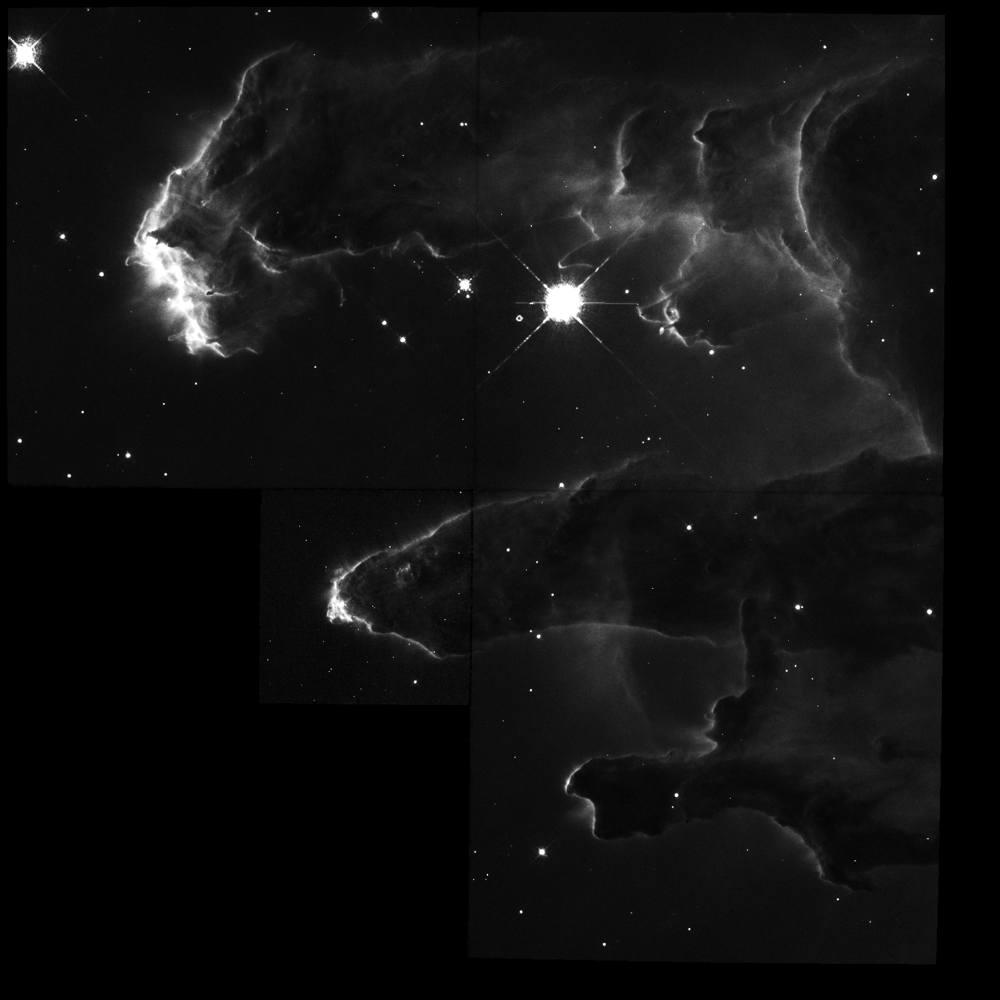

<h1 align="center">
  
</h1>

[![Continuous Integration][badge-ci]][workflow-ci]
[![API Docs][badge-docs]][site-docs]

## Astronomical and Spacecraft Toolkit Written in Zig

astroz is an astrodynamics and spacecraft toolkit with a fast SGP4/SDP4 propagator at its core.

| Orbital Mechanics | Spacecraft Ops | Astronomy |
|-------------------|----------------|-----------|
| SGP4/SDP4 propagation | CCSDS packets | FITS parsing |
| TLE & OMM parsing | VITA49 packets | WCS coordinates |
| Orbital maneuvers | Attitude determination | Star precession |
| Force models (J2-J4, drag, SRP, third-body) | CSPICE ephemeris | Celestial bodies |
| Dormand-Prince 8(7) integrator | Monte Carlo sims | |

### Performance

SGP4 (near-earth) or SDP4 (deep-space) is picked per satellite from its orbital period. Satellites are propagated 8 at a time with SIMD (AVX512, or AVX2/SSE at 4 wide), and constellations are split across threads in time-major order. `ASTROZ_THREADS` sets the thread count; the default is every available core.

#### Single-Threaded (1.2M propagations, single satellite)

| Implementation | Props/sec | Speedup vs python-sgp4 |
|----------------|-----------|------------------------|
| astroz | 30.8M | 11x |
| Rust sgp4 | 5.1M | 1.8x |
| heyoka | 3.8M | 1.3x |
| satkit | 3.5M | 1.2x |
| python-sgp4 | 2.8M | 1x |

#### Multi-Threaded Constellation (13,478 satellites × 1,440 times)

| Implementation | 1 Thread | 16 Threads |
|----------------|----------|------------|
| astroz | 37.7M/s | 303M/s |
| heyoka | 15.7M/s | 155.6M/s |
| Rust sgp4 (rayon) | 4.4M/s | 47.9M/s |
| satkit | 3.5M/s | 3.5M/s |
| python-sgp4 | 2.7M/s | 2.7M/s |

*Measured on an AMD Ryzen 7 7840U (16 threads), each implementation in its fastest configuration (SIMD, pre-allocated outputs, batch mode). The scripts for astroz, Rust sgp4 and python-sgp4 are in [benchmarks/](benchmarks/) (see the Justfile).*

The [Cesium visualization example](examples/README.md) propagates the whole active catalog (about 13,000 satellites) at interactive rates. There is a [live demo](https://attron.github.io/astroz-demo/).

### Accuracy

What the test suite checks (`zig build test`):

| Component | Reference | Tolerance |
|-----------|-----------|-----------|
| SGP4 | Vallado AIAA 2006-6753 vectors | 10 m position, 1 mm/s velocity |
| SDP4 (GPS, GEO, HEO) | python-sgp4 | 10 m position |
| SGP4 over one day | python-sgp4 | 100 m position, 0.1 m/s velocity |
| J2 acceleration | Analytical | 1% |
| Two-body propagation | Analytical Kepler | 1 m after one orbit |
| Two-body energy | Conservation | 1e-10 relative over 100 orbits |

CI also checks the Python bindings against python-sgp4 to within 1 m.

With CSPICE enabled: `zig build test -Denable-cspice=true`

### Python

Wheels are published for Linux (x86_64, arm64) and macOS (arm64), Python 3.10 to 3.14:

```bash
pip install astroz
```

`astroz.api` follows the [python-sgp4](https://github.com/brandon-rhodes/python-sgp4) API and also handles deep-space (SDP4) satellites:

```python
from astroz.api import Satrec, jday, WGS72

line1 = "1 25544U 98067A   24127.82853009  .00015698  00000+0  27310-3 0  9995"
line2 = "2 25544  51.6393 160.4574 0003580 140.6673 205.7250 15.50957674452123"
sat = Satrec.twoline2rv(line1, line2, WGS72)

jd, fr = jday(2024, 5, 6, 12, 0, 0.0)
error, position, velocity = sat.sgp4(jd, fr)
```

The [Python README](bindings/python/README.md) covers batch propagation, the high-level `propagate`/`screen` API, orbital mechanics helpers and numbers for migrating from python-sgp4.

### Usage

Requires Zig 0.17.0.

- Fetch the package so it gets recorded in your `build.zig.zon`. Pin a release tag or commit for reproducible builds, or follow the latest `main`:

```sh
# pinned to a tag or commit
zig fetch --save https://github.com/ATTron/astroz/archive/<tag-or-commit>.tar.gz

# latest main
zig fetch --save git+https://github.com/ATTron/astroz
```

- Wire the `astroz` module into your compile step in `build.zig`:

```zig
const astroz = b.dependency("astroz", .{ .target = target, .optimize = optimize });
exe.root_module.addImport("astroz", astroz.module("astroz"));
```

- Propagate a satellite. `Satellite` picks SGP4 or SDP4 for you:

```zig
const astroz = @import("astroz");

var tle = try astroz.Tle.parse(tle_string, allocator);
defer tle.deinit();

const sat = try astroz.Satellite.init(tle, astroz.constants.wgs84);
const result = try sat.propagate(60.0); // minutes from epoch
const pos = result[0]; // [x, y, z] km
const vel = result[1]; // [vx, vy, vz] km/s
```

### Examples

Run them all with `zig build example`, or only compile them with `zig build build-examples`.

Zig

- [sgp4.zig](examples/sgp4.zig): TLE and OMM parsing (including six-digit catalog numbers), SGP4 one time and eight at once with SIMD, `Satellite` picking SGP4 or SDP4, and the Earth-fixed position.
- [constellation.zig](examples/constellation.zig): a mixed near-earth and deep-space constellation propagated in batches, then screened for close approaches with `Screening`.
- [numerical_propagation.zig](examples/numerical_propagation.zig): one orbit propagated with two-body (RK4 and Dormand-Prince 8(7)), with J2, and with J2, solar radiation pressure and Sun/Moon gravity. Uses SPICE ephemeris when built with `-Denable-cspice=true` after `zig build fetch-kernels`.
- [spacecraft.zig](examples/spacecraft.zig): impulse, plane change and phase change maneuvers and how they change the orbit, then attitude propagation.
- [mission_design.zig](examples/mission_design.zig): Earth to Mars by Hohmann and bi-elliptic transfer, the transfer propagated, and Monte Carlo statistics on it.
- [packets.zig](examples/packets.zig): building and parsing CCSDS packets and parsing a VITA 49 stream.
- [astronomy.zig](examples/astronomy.zig): star precession and reading a FITS image into a PNG.

  

Python

- [python_sgp4.py](examples/python_sgp4.py): the python-sgp4 compatible API.
- [constellation.py](examples/constellation.py): loading a constellation from CelesTrak or a TLE/OMM file, propagating to Earth-fixed and geodetic coordinates, and screening it for close approaches.
- [orbital_mechanics.py](examples/orbital_mechanics.py): circular-orbit numbers, Hohmann and bi-elliptic transfers, Lambert's problem and numerical propagation with J2.
- [Cesium visualization](examples/README.md) ([live demo](https://attron.github.io/astroz-demo/)): the active catalog propagated and rendered in Cesium.

<!-- MARKDOWN LINKS -->

[badge-ci]: https://img.shields.io/github/actions/workflow/status/ATTron/astroz/ci.yaml?branch=main&label=tests&logo=githubactions&logoColor=white&labelColor=black
[workflow-ci]: https://github.com/ATTron/astroz/actions/workflows/ci.yaml
[badge-docs]: https://img.shields.io/badge/docs-online-F7A41D?logo=zig&logoColor=F7A41D&labelColor=black
[site-docs]: https://attron.github.io/astroz
